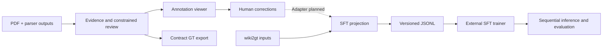

# FolioScribe

**Document annotation and multipage parsing, with a shared state machine for training and inference.**

[简体中文](README.zh-CN.md) · [Architecture](docs/architecture.md) · [Model deployment](docs/deployment/README.md) · [Development](CONTRIBUTING.md) · [Roadmap](ROADMAP.md)

FolioScribe brings evidence-based OCR review, a browser annotation workspace, and multipage SFT data preparation into one repository. Inspect parser outputs against the page, correct layout and content, and build training targets that preserve headings and cross-page continuations.

> **Development preview.** The annotation viewer and synthetic training example run locally without a model API or GPU. The annotation-to-training adapter is still planned; see the [roadmap](ROADMAP.md).


## What you can do

- **Review with evidence.** Compare MinerU, PaddleOCR, PDF evidence and final blocks; inspect table HTML, reading order, headings and captions.
- **Correct in the browser.** Draw and edit boxes, edit text and tables, merge blocks, undo/redo, mark difficult pages and connect content across pages. Failed saves keep the page open with retry and draft export controls.
- **Export structured annotations.** Project OCR-Agent results into graph, geometry and A1/A2/A3 fact artifacts. External schemas are optional; missing schemas are explicitly reported as unvalidated.
- **Prepare multipage SFT data.** Convert wiki2gt-shaped inputs into six-type marked Markdown, using the same document state machine for training context and inference context.
- **Evaluate sequentially.** Use an OpenAI-compatible vision endpoint for document-by-document evaluation, with independent documents processed concurrently.

## Try it in five minutes

Python **3.11+**. Run these commands from a checkout of this repository:

```bash
git clone https://github.com/bin-Deng-666/folioscribe.git
cd folioscribe
python -m venv .venv
source .venv/bin/activate
python -m pip install -e '.[dev]'

python examples/make_viewer_demo.py --output data/viewer-demo
folioscribe-viewer --data-root data/viewer-demo
```

Open **http://127.0.0.1:8745**. The demo generates two synthetic documents. Switch to **标注 / Annotate**, select a block, and edit it. No credentials or external dataset are needed.

The viewer currently uses a Chinese interface. `Q/E` changes pages, `A/D` changes documents, `B` draws a box, and `Ctrl/Cmd+S` saves. Use the page-number input to jump directly or **下一未标注页** to continue your work.

Try the training data path separately:

```bash
python examples/make_demo.py --output data/training-demo
folioscribe-project --input-root data/training-demo --roundtrip
python components/training/scripts/build_train_set.py \
  --input-root data/training-demo --output data/datasets --split train
```

This creates three page-level samples with a continuing table, a clean ms-swift JSONL file and a versioned manifest. It prepares data; it does not launch model training.

## How it fits together



The annotation engine preserves **13 block types**, evidence references and review status. The training format uses **six types**: header, footer, title, text, table and image. These are different representations with different responsibilities; [the architecture notes](docs/architecture.md) document the boundary.

## Use your own data

To review existing OCR-Agent outputs:

```bash
folioscribe-viewer --data-root /path/to/annotation-batch
```

The batch must contain `runs/<sample>/page_XXXX/result.json` and matching `evidence/<sample>/page_XXXX.json`. Image paths in evidence must be available locally. Human corrections are stored under `annotations/`. See the [viewer guide](components/annotation/viewer/README.md).

For PDF evidence construction, install `.[annotation]` and follow the [annotation guide](components/annotation/README.md). For dataset preparation, evaluation and training environment notes, see the [training guide](components/training/README.md). Real model review requires your own API configuration; copy `.env.example` and load it explicitly.

## Repository layout

```text
components/
  annotation/
    src/ocr_agent/     Evidence, constrained review, cross-page links, GT export
    viewer/           Full annotation UI, backend, guide and static assets
    scripts/          Build, review, export and audit tools
    tests/            Existing annotation regression suite
  training/
    sft/              Output format, document state, projection primitives
    scripts/          Dataset preparation, evaluation and baseline tools
examples/             Synthetic viewer and training demos
benchmarks/           Reproducible CPU benchmarks
tests/                Cross-component, training and browser regressions
scripts/deployment/   Model downloads and service launch templates
docs/deployment/      MinerU, Paddle, Ovis, Qwen and Logics setup guides
docs/                 Architecture and usage guides
```

The distribution and commands use `folioscribe`; the annotation and training Python packages are `ocr_agent` and `sft`.

## Development

```bash
python -m pytest -q --ignore=tests/browser
ruff check .
node --check components/annotation/viewer/static/app.js
```

Optional browser regressions:

```bash
python -m pip install -e '.[browser]'
python -m playwright install chromium
python -m pytest -q tests/browser
```

CI runs CPU tests on Python 3.11–3.13, checks JavaScript syntax, builds the wheel, verifies packaged viewer assets, and runs browser regressions. Tests requiring the external DocFusion schemas run when `DOCPARSE_SCHEMA_ROOT` is set.

## Current limits and next work

- **GT integration:** the current SFT projector consumes wiki2gt, whose filenames and raw structure differ from annotation exports. A tested adapter for human corrections is still needed.
- **Training reproducibility:** CUDA, model checkpoints and the ms-swift training environment are external. GPU deployment recipes require validation on your target hardware; this repository does not provide a verified training launcher or an accuracy benchmark.
- **Compatibility:** `contract-v3.1` / `prompt-v7` fixes previous-state context, multiline DSL parsing and continuation handling. Rebuild datasets and rerun evaluation before comparing checkpoints.
- **Engineering:** evidence construction and the viewer frontend remain large modules. Further extraction will follow behavior-preserving tests and profiling.

## License

FolioScribe is licensed under [Apache-2.0](LICENSE). Optional dependencies and downloaded models retain their own licenses, including PyMuPDF's AGPL/commercial terms. See [third-party notices](THIRD_PARTY_NOTICES.md).

Contributions should explain the failure case, preserve evidence and data provenance, and include focused regression coverage for behavior changes. See [CONTRIBUTING.md](CONTRIBUTING.md).
