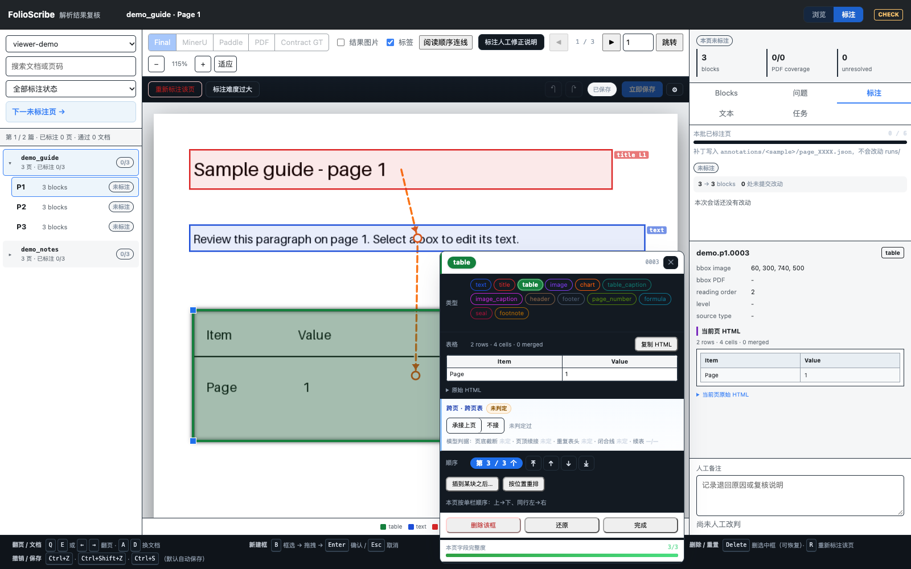
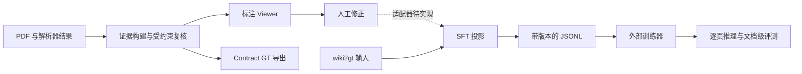

# FolioScribe

**文档标注与多页解析：让训练和推理共用同一份文档状态。**

[English](README.md) · [架构](docs/architecture.md) · [模型部署](docs/deployment/README.md) · [开发规范](CONTRIBUTING.md) · [路线图](ROADMAP.md)

FolioScribe 将有证据支撑的 OCR 复核、浏览器标注工作台和多页 SFT 数据构建放进一个仓库。你可以对照页图检查解析结果，修正框、文本、表格和阅读顺序，并构建包含标题层级与跨页续接信息的训练目标。

> **开发预览版。** Viewer 与合成训练样例可在本地运行，不需要模型 API 或 GPU。人工标注到训练输入的适配器尚待实现，后续工作见[路线图](ROADMAP.md)。



## 核心能力

- **基于证据复核**：对照 MinerU、PaddleOCR、PDF 和最终块，检查表格 HTML、阅读顺序、标题及图注。
- **完整标注工作台**：新建和调整 bbox、编辑文本和表格、合并块、撤销/重做、标记难页、建立跨页链接。保存失败时保留当前页，提供重试和本页改动导出。
- **结构化 GT 导出**：生成文档图、几何及 A1/A2/A3 事实产物；缺失外部 schema 会明确报告未校验。
- **多页训练数据**：将 wiki2gt 输入投影成六类型 Markdown DSL，训练上下文和推理上下文使用同一状态机。
- **文档级评测**：对接 OpenAI-compatible 视觉模型接口，文档之间并发、文档内逐页推理。

## 五分钟体验

需要 Python **3.11+**，在仓库根目录运行：

```bash
git clone https://github.com/bin-Deng-666/folioscribe.git
cd folioscribe
python -m venv .venv
source .venv/bin/activate
python -m pip install -e '.[dev]'

python examples/make_viewer_demo.py --output data/viewer-demo
folioscribe-viewer --data-root data/viewer-demo
```

打开 **http://127.0.0.1:8745**。样例会生成两篇合成文档，点击「标注」后即可选择框并编辑，不需要真实业务数据。

快捷键：`Q/E` 翻页，`A/D` 切换文档，`B` 新建框，`Ctrl/Cmd+S` 保存。工具栏支持直接跳页，左侧支持「下一未标注页」。Viewer 当前界面语言为中文。

独立体验训练数据链路：

```bash
python examples/make_demo.py --output data/training-demo
folioscribe-project --input-root data/training-demo --roundtrip
python components/training/scripts/build_train_set.py \
  --input-root data/training-demo --output data/datasets --split train
```

输出包括三页跨页续表样本、可供 ms-swift 消费的 JSONL 和格式版本 manifest。此步骤只准备训练数据，不启动训练。

## 两条链路如何连接



标注侧保留 **13 种类型**及证据和复核状态；训练侧使用 **6 种类型**：header、footer、title、text、table、image。它们承担不同职责，不能直接按文件名拼接。字段与数据格式差异见[架构文档](docs/architecture.md)。

## 使用真实数据

查看已有 OCR-Agent 批次：

```bash
folioscribe-viewer --data-root /path/to/annotation-batch
```

输入需要 `runs/<sample>/page_XXXX/result.json` 及对应的 `evidence/<sample>/page_XXXX.json`，证据内页图路径须在当前机器可读。人工改动写入 `annotations/`。见 [Viewer 使用说明](components/annotation/viewer/README.md)。

PDF 证据构建需要安装 `.[annotation]`，按[标注组件文档](components/annotation/README.md)配置输入路径。数据集、评测与外部训练环境见[训练组件文档](components/training/README.md)。调用模型复核前请自行配置 API，可从 `.env.example` 建立本地环境文件并显式加载。

## 仓库结构

```text
components/annotation/   证据构建、复核、GT 导出、完整 Viewer 与已有测试
components/training/     格式协议、文档状态机、训练投影与评测脚本
examples/               不含真实业务数据的 Viewer / 训练演示
benchmarks/             可复现的 CPU 性能测量
tests/                  跨组件、训练和浏览器回归
scripts/deployment/     模型下载与服务启动模板
docs/deployment/        MinerU、Paddle、Ovis、Qwen、Logics 部署指南
docs/                   架构与使用指南
```

安装包和命令命名为 `folioscribe`，标注和训练模块的 Python 导入名为 `ocr_agent`、`sft`。

## 开发验证

```bash
python -m pytest -q --ignore=tests/browser
ruff check .
node --check components/annotation/viewer/static/app.js
```

浏览器回归：

```bash
python -m pip install -e '.[browser]'
python -m playwright install chromium
python -m pytest -q tests/browser
```

CI 覆盖 Python 3.11–3.13、JavaScript 语法、wheel 构建和静态资源打包、浏览器交互。外部 DocFusion Schema 测试需要设置 `DOCPARSE_SCHEMA_ROOT`。

## 当前边界与后续方向

- **标注与训练桥接**：训练投影器当前消费 wiki2gt；人工修正和 annotation GT 的文件名、原始结构不同，需要专门适配器及端到端测试。
- **训练复现**：CUDA、模型权重和 ms-swift 环境属于外部依赖；部署配方需要在目标 GPU 验证，目前没有经过验收的训练 launcher 或真实语料精度基准。
- **数据兼容**：`contract-v3.1` / `prompt-v7` 修复了上下文泄漏、多行 DSL 和跨页续接，旧训练集必须重建，旧模型评测应重跑后再比较。
- **代码优化**：证据构建和 Viewer 前端仍较大，后续依据回归基线与性能测量继续拆分。

## 许可证

FolioScribe 源码采用 [Apache-2.0](LICENSE)。可选依赖与下载模型保留各自许可，包括 PyMuPDF 的 AGPL/商业授权条款，详见[第三方说明](THIRD_PARTY_NOTICES.md)。

参与开发前请阅读 [CONTRIBUTING.md](CONTRIBUTING.md)。行为改动需要说明失败案例及验证方式，维护证据与数据来源的可追溯性。
